# Architecture

How the redaction benchmark is put together and how work moves through it. This describes
the code on branch `feat/benchmark-integration` as of 2026-10-22: commit `a6b0e8b` plus the
follow-ups of that day (policy 1.1.0 and its departures, the `{policy}`, `{matter}` and
`{env:NAME}` placeholders, the run's policy record, the ceiling mock).

- For why it is designed this way, see [PLAN.md](PLAN.md).
- For exact metric definitions and thresholds, see [docs/metrics.md](docs/metrics.md).
- For the contract candidate tools must follow, see [docs/adapter_guide.md](docs/adapter_guide.md).

The [mental model](#mental-model) at the end summarises everything on one page.

## What the system does

The benchmark compares PII-redaction tools for Australian medico-legal PDFs, most of which
are scans. For each tool it answers four questions:

- Is any required PII still exposed?
- What else did the tool damage?
- Which stage caused each failure?
- Does the tool behave the same way every time?

It is an **offline evaluation pipeline built around files**. Each tool runs as a separate
program and writes files, and the benchmark scores those files against ground truth (GT).
The score depends only on the dataset, the GT, the policy, the evaluation settings and the
tool's files. So when the GT, the policy or a metric changes, a run can be scored again
without running the tool again. One caveat: a tool that follows the run's policy (it is passed
as `{policy}`; every mock does) was given that policy, so scoring its run under another one
judges it against rules it never saw. The run records its policy, and scoring warns when the two
differ.

These rules hold across the whole codebase:

- **Judge the output, not the tool's claims.** The redacted PDF is always required and
  always evaluated. A required mention is safe only if its original content cannot be seen
  in any viewer, cannot be recovered from the file, and cannot be brought back by boosting
  contrast.
- **GT records facts; the policy sets requirements.** GT records what each span *is*: its
  type, the person it belongs to, their role and its position. A separate, versioned policy
  decides what MUST, MAY or MUST_NOT be redacted. Changing the policy never requires new
  annotation.
- **One common space.** All coordinates are converted to one standard page frame: points on
  the page as displayed, origin at the top left. Every claim a tool makes is mapped onto the
  GT words it covers. This makes tools with different OCR, tokenisation and reading order
  directly comparable.
- **A missing stage is N/A, never zero.** If a tool does not expose a stage, that stage is
  not scored. Files a tool did not declare in its manifest are ignored, except `run_info.json`,
  whose release verdict is always graded.
- **The client's rules are the yardstick.** The default policy is the client's decisions
  (`au-medicolegal-v1.yaml`, 1.1.0): every required item must be replaced by a realistic fake,
  and hiding it without one is its own verdict, `NOT_REPLACED`. Where the policy departs from the
  client's answers on purpose, every report says so.
- **Confirmed and inferred causes are kept apart.** Every root cause is labelled
  *confirmed* (backed by the tool's files or an oracle run) or *inferred* (a black-box
  guess). The two are never counted together.
- **Treat everything as sensitive.** Source PDFs, real-document GT, runs, results and
  reports are kept out of git. PDFs are stored under their SHA-256 hash, and tools receive
  files with neutral names.

## System context

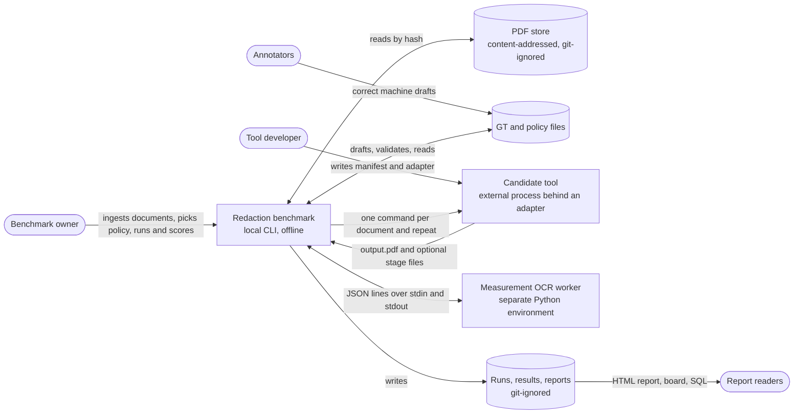

- Everything runs on the local machine. Only two things run outside the benchmark's own
  Python process:
  - the candidate's adapter command;
  - the optional measurement-OCR worker. It has its own Python environment because its
    pinned dependencies conflict with the benchmark's.
- The client allows the five representative PDFs to be shared and published (PLAN.md §16,
  Q12). The git-ignore rules stay in place until the remaining data-governance questions are
  decided.

## User journeys

| Journey | Who | Steps | Result |
|---|---|---|---|
| Evaluate a tool | Benchmark owner | Run, score, report | Scorecard, failure funnel, gallery of failures |
| Connect a new tool | Tool developer | Write manifest and adapter, validate the output files, run on the synthetic dataset | A working adapter and a first report on shareable data |
| Annotate a real document | Annotators and owner | Ingest, draft, annotate, validate, measure agreement, self-check | Released GT for that document |
| Find which stage fails | Benchmark owner | Normal (e2e) run plus oracle runs, score with the oracle results, build a board | The failure rate split by stage |
| Track a tool across versions | Owner and developer | Compare two runs, promote failures to regression cases, check them | Fixed and regressed mentions, a regression check |
| Test robustness | Benchmark owner | Build a degradation ladder, run, build a board | Leak rate against DPI, skew, JPEG quality, noise and blur |

## Stage model and component isolation

The benchmark does not require tools to have any particular internal structure. It only
assumes a set of *interfaces* between stages. A tool may combine several stages; it then
exposes fewer interfaces. Each interface serves two purposes:

- it is a claim the benchmark can score;
- it is an injection point where the benchmark can replace the tool's input with perfect
  input built from GT. Runs that do this are called *oracle runs*.

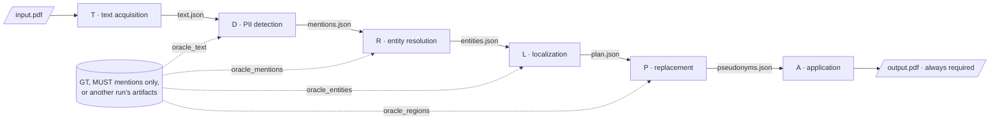

- Injected input contains only the mentions the policy marks MUST. It is what a perfect
  upstream stage would hand over. Each mode injects everything upstream of its stage:
  `oracle_regions` gives text, mentions, entities and the plan, and every planned region carries
  the policy's action (`replace` or `remove`) and names its mention. The tool still has to draw
  the right kind of fake there, so that run tests replacement as well as application.
- An experiment can inject another candidate's files instead of GT. This is *stage
  swapping*: for example, tool A's OCR output fed into tool B's detector. The swapped files
  are first converted to the standard frame and to the benchmark's labels.
- Failure rates from oracle runs split the end-to-end (e2e) failure rate by subtraction. The
  failure rate counts leaks and required replacements that were not made, so a tool that hides
  everything but replaces nothing shows its failures in the last stage. The intermediate terms
  cancel out, so the parts add up to the e2e rate:

  | Stage | Share of the failure rate |
  |---|---|
  | Text acquisition | e2e − oracle_text |
  | Detection | oracle_text − oracle_mentions |
  | Resolution | oracle_mentions − oracle_entities |
  | Localization | oracle_entities − oracle_regions |
  | Application, including replacement | oracle_regions |

- Tools that accept no injected input can still be analysed by stage through controlled
  inputs. Both work on any document that has GT:
  - **Clean twins:** the same words set in a born-digital page at the same positions, with
    perfect image quality.
  - **Single-factor degradation ladders:** the page degraded step by step in one factor
    (DPI, skew, JPEG quality, noise or blur), with the GT transformed exactly along with it.

What a tool declares in its manifest decides what gets scored. (PLAN.md calls these
combinations capability tiers T0–T4.)

| Declared files | What is scored |
|---|---|
| Output PDF only | End-to-end safety, over-redaction and integrity; detection measured from the output pixels; entity resolution inferred from the tool's pseudonyms; inferred root causes |
| + plan | Adds localization: how much of each mention's ink the planned regions cover, spill outside it, and diagnosis of coordinate bugs. Also compares the plan with what was actually applied |
| + mentions | Adds detection: strict, exact-boundary, tolerant and partial matching, boundary classes, type confusion |
| + text | Adds text acquisition: CER/WER, the same rates restricted to PII words, reading order |
| + entities | Adds entity resolution from the tool's own clusters (without them it is inferred from the fakes in the output), and lets a pseudonym inconsistency or collision be traced to a resolution split or merge |
| + pseudonyms | Adds the tool's replacement mapping to the determinism check. The pseudonym checks themselves always read the fakes from the output |

## Running a candidate

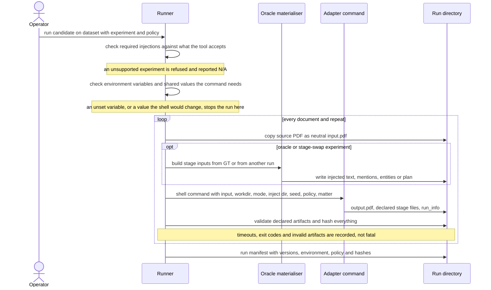

- **The manifest** declares:
  - the command template, and a version or a command that prints it;
  - which files the tool provides;
  - which injected inputs it accepts;
  - how its labels map onto the benchmark's PII types;
  - its coordinate frame;
  - its seed flag, its time limit and extra environment variables.
- **The command contract.** Placeholders give the tool its input, working directory, mode,
  inject directory and seed, the path of the run's policy (`{policy}`), the document's matter
  (`{matter}`, so a tool can keep one fake per person across a matter) and the value of an
  environment variable (`{env:NAME}`, which points at the tool's own interpreter). Every value
  reaches the tool unchanged as one argument: the runner quotes it for the shell, and on Windows
  refuses a value `cmd.exe` would still change (a double quote, `%`, `!` or a line break) instead
  of passing it on altered. Matter ids are plain codes by schema.
- **Each document and repeat gets its own working directory.** It holds only `input.pdf`
  and, in oracle modes, the injected files. GT is never placed there.
- **Output files are validated against strict schemas.** A file is rejected, with a reason,
  if it is malformed or uses a coordinate frame other than the declared one. Rejected files are
  never repaired. Labels missing from the label map are reported as invalid too, but those
  mentions are still scored, with no type.
- **Failures are recorded, not fatal.** Timeouts, non-zero exit codes and invalid files are
  recorded per item. A timed-out command is stopped with every process it started. A document
  with no output later scores as `NO_OUTPUT`, which counts as unprotected in the strict view;
  so does an output written or changed after the run recorded the item. Any output the tool did
  write in time is graded, whatever its exit code.
- **The run manifest records:**
  - the benchmark version and git state;
  - the hash of the dataset manifest;
  - the candidate's version and the hash of its manifest;
  - the environment and package versions;
  - the policy the run was made with: name, version, SHA-256 of the file and its path;
  - the SHA-256 of every input, injected file and output file.

## Scoring a run

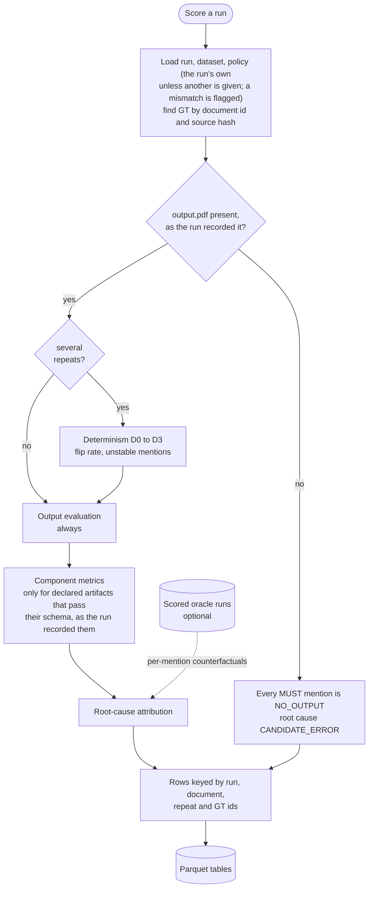

For each document, scoring always evaluates the output. It then computes component metrics
only for the stages the candidate exposed, and finally attributes a root cause to each
failure. If there are several repeats, it first compares them for determinism. Mentions
whose verdict changes between repeats are tagged `NONDETERMINISTIC`.

Across documents, scoring also grades the tool's own release verdict from `run_info.json`
(correct release, correct hold, false alarm, unsafe release) and checks that each person keeps
one fake across the documents of a matter (the `matters` table, grouped by the GT's matter).
`scoring.json` records the scoring policy and its departures from the client's answers, the
policy the run was made with, a warning when the two differ, and the GT version and hash used
for each document.

### Output evaluation

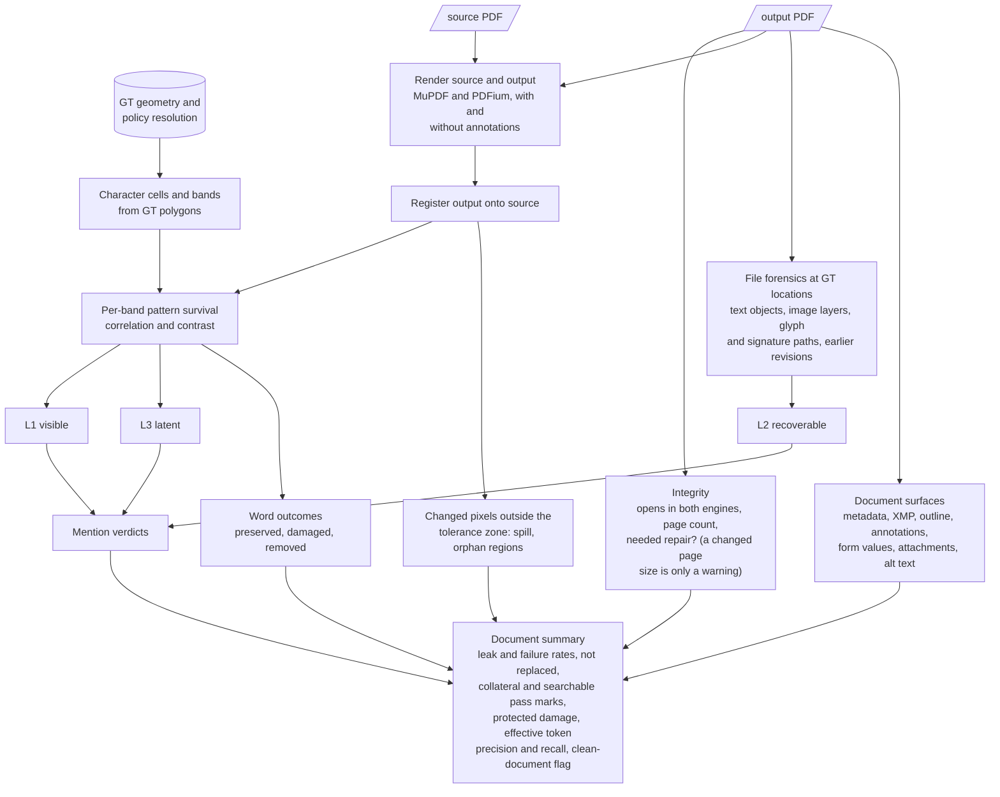

- **Bands.** Pixel evidence is collected per *band*: each character cell is cut into four
  strips across the text line. Bands are combined into per-character results by a run rule.
  The rule ignores isolated chance matches, but it still catches a box shifted half a line,
  which leaves the tops of the letters readable.
- **Visible or latent (L1, L3).** For each band the original and output renderings are
  compared on two measures: correlation (does the original pattern survive?) and contrast
  ratio (is it visible?).
  - A black box over black text leaves no correlation, so the text counts as hidden.
  - A box that is 90% opaque keeps the correlation but loses the contrast. That content is
    **latent**: not visible at a glance, but recoverable by boosting contrast.
- **Recoverable from the file (L2).** The evaluator looks for the original content at the GT
  location in four places:
  - text objects, in any render mode, including invisible text;
  - each image layer on its own. This catches boxes drawn over an untouched scan, and
    layered scans (MRC) where only some layers were edited;
  - glyph paths, and the pen strokes of a drawn signature or mark, that survive under a
    covering shape. A pen stroke survives only as the very same path, so a new stand-in drawn
    to the original's size is not taken for it; straight rules and boxes inside a signature
    region belong to the form, and the glyphs of kept words drawn there (a "Signed:" label) are
    kept text, so neither is counted (eval-0.3.1);
  - earlier revisions saved incrementally in the file.
- **Document-level findings.** The evaluator searches for terms from required mentions in
  metadata, XMP, outlines, annotation contents, form values, attachment names,
  structure-tree alt text and unreferenced streams.
- **Over-redaction.** Every GT word is also classed as PRESERVED, DAMAGED or REMOVED. This
  gives two measures:
  - collateral damage: ordinary words lost;
  - protected damage: content that must survive, such as clinical terms, medications,
    citations, eponyms, surnames that are also ordinary words, and dates under the current
    policy.
- **Thresholds.** All thresholds live in one frozen, versioned evaluation configuration. A
  digest of it is stored with every result, so changing any threshold creates a new
  evaluation version.

### Mention verdict

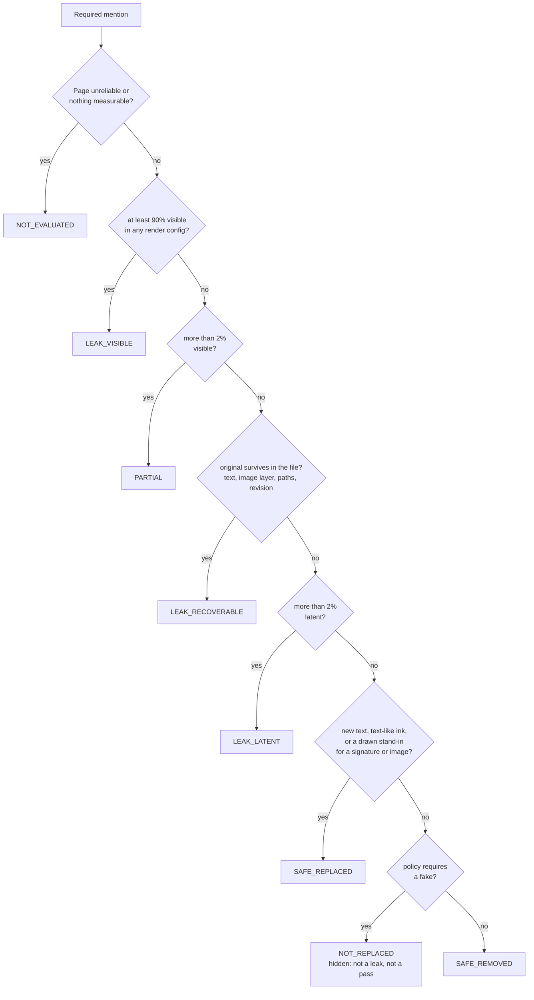

A required mention whose run produced no output (or whose output appeared after the run
recorded it) is `NO_OUTPUT`, assigned by scoring. The **leak rate** counts required mentions that
are not hidden; the **failure rate**, the client's bar, also counts `NOT_REPLACED`.

A document is **clean** when all of the following hold:

- integrity checks pass;
- no required mention is PARTIAL, LEAK_VISIBLE, LEAK_RECOVERABLE or NOT_REPLACED (a
  latent-only leak does not count against this);
- there are no document-level findings;
- no protected word is damaged;
- every required mention was evaluated;
- at most 1% of its ordinary words (two or more letters or digits) are damaged or removed
  (client Q16);
- at least 95% of its kept words are found in the output's text layer at their place (client
  Q11): an image-only output fails.

### Root-cause attribution

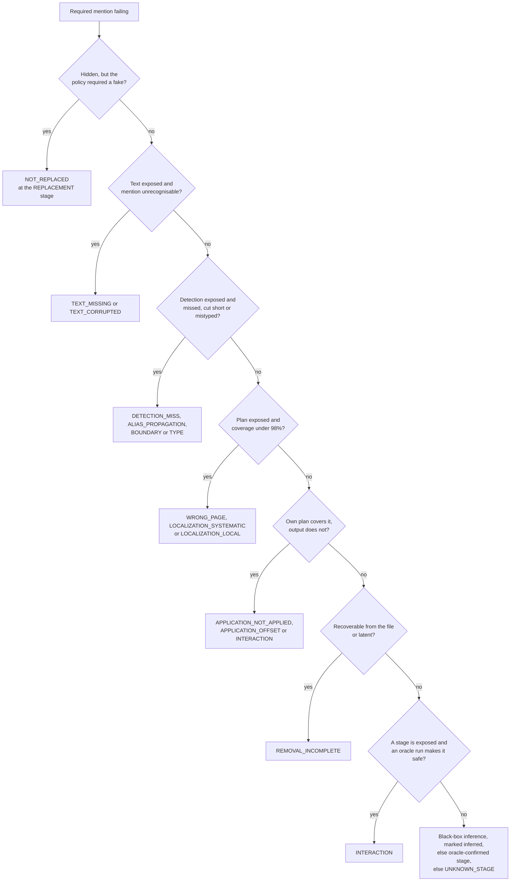

- **First failing stage.** The root cause is the first stage, in pipeline order, that fails
  even though its input was correct.
  - It is **confirmed** when it rests on the tool's own files or on an oracle run.
  - It is **inferred** when it rests on a black-box guess, such as a stray redaction box
    next to the missed mention, or the same person's name redacted elsewhere.
- **Oracle evidence.** An oracle run can confirm a stage. For example, a mention that leaks
  end-to-end but is safe when GT text is injected confirms an OCR failure. If every exposed
  stage looks correct and yet perfect upstream input fixes the mention, the cause is
  `INTERACTION`: each stage works alone but the combination fails.
- **Tags on safe mentions.** A mention can be safe and still carry tags: inconsistent or
  colliding pseudonyms (a collision is one fake for two people with different names; one
  person written two ways, or two people sharing a surname, may share one), an invalid
  replacement format, a gender mismatch, a surviving original name part, or nondeterminism. If
  the tool's own entity clusters split or merged that person, the pseudonym tag is replaced by
  a resolution failure.
- **Over-redaction causes.** Over-redacted words are attributed separately:
  - confirmed: a false-positive detection, or localization spill;
  - inferred: replacement text overflowing its space, or spill during application.
- **The funnel** counts how many required mentions survive each stage: required →
  recognised → detected → planned → visually safe → truly safe (hidden) → replaced as required.
- **A failed run** gives `CANDIDATE_ERROR` for every required mention of the document.

## Determinism

- An experiment can run each document N times, optionally with a different seed for each
  repeat.
- Four levels are reported separately:
  - **D0:** byte-identical files (for information only).
  - **D1:** identical stage files once normalised. Mentions are compared as sets of GT
    words, clusters as groupings, and plans as rasterised masks.
  - **D2:** identical rendered pages, both exactly and with a tolerance for anti-aliasing,
    plus the overlap (IoU) of the changed-pixel masks.
  - **D3:** identical per-mention verdicts, with a flip rate and a list of the mentions
    whose verdict changes.
- The evaluator itself is deterministic: scoring the same files twice gives identical
  results. A test checks this.

## Ground truth lifecycle

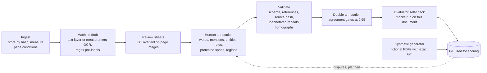

- **Synthetic documents skip the human steps.** The generator writes fictional PDFs in nine
  encodings with exact GT, and registers them as a dataset.
- **Drafts come only from the benchmark's own tools:** the PDF's text layer, the measurement
  OCR and regular expressions. Candidate output is never used. Every pre-labelled mention
  is marked as a pre-label and has no person assigned until an annotator assigns one.
- **The self-check re-tests the thresholds on real documents.** It runs the fault-injecting
  mock tools on the newly annotated document and checks that the evaluator reaches the
  expected verdict for each fault. The thresholds were calibrated on synthetic documents,
  so this is how they are checked against real layouts, scans and fonts. A check that breaks
  is recorded as an error, named by its exception's class only, and the other checks and
  documents still run.
- **The policy is the client's.** The default, `au-medicolegal-v1.yaml` (1.1.0), encodes the
  client's questionnaire answers; only quasi-identifiers the questionnaire did not ask about stay
  MAY, neither rewarding nor penalising a tool. It departs from the answers in two places, each
  recorded under `deviations` and shown in every report and board: the whole address is
  replaced (Q4), because the project owner decided on 2026-10-22 that every tool replaces whole
  addresses (a check of the rule-based address splits of GT 0.2 does not end it; only the owner
  can), while a suburb or town mentioned on its own is still kept; and role words such as "the
  claimant" are left as they are (Q10). The GT's LOCATION subtype decides keep or replace, so
  `locality` is reserved for the locality part of an address and `rb gt validate` warns
  otherwise. The draft policy (`au-medicolegal-v0.yaml`) stays for re-scoring old runs and for
  the benchmark's own tests.

## Results and reporting

- **Results tables.** Scoring writes tidy long-format tables: documents, mentions, words,
  components, determinism, findings and matters (one fake per person across a matter). They are
  keyed by run, document, repeat and GT ids. Document rows also carry the GT version and hash
  and the grading of the tool's own release verdict (`self_check.*`). A new question is
  answered with a new SQL group-by, not new code.
- **Run report.** A static HTML page that works offline. It contains:
  - the policy the scores use and, in a marked section above the scorecard, its departures from
    the client's answers; a warning when the tool was given another policy than the scores use;
  - a scorecard with document-level bootstrap confidence intervals and sample sizes (n),
    including the not-replaced and searchable rates;
  - component metrics and a per-document table;
  - breakdowns by PII type, document condition and page encoding;
  - the failure funnel and root causes;
  - determinism results;
  - a gallery of failures showing the original and output crops side by side.
- **Board.** One page covering several runs:
  - the departures of the runs' policies, each shown once; when the runs were scored under
    different policies, the board says so and each departure names its runs;
  - a warning for any run scored under another policy than its tool was given;
  - a scorecard (with no combined score) with the policy of each row, the failure and
    not-replaced rates, the same-fake-across-matter check and the counts of the tools' release
    verdicts;
  - heatmaps by PII type, condition and encoding;
  - the mix of failure categories;
  - the per-stage split from oracle runs;
  - leak-rate curves along the degradation ladders.
- **The ceiling.** `candidates/mock-reference-replace.yaml` runs a mock that does everything
  the client's rules ask, under the run's policy: a fake of the right kind for every required
  item (one fake per person across a matter, its own fake for every phone and Medicare number),
  a drawn stand-in for every signature or image and a searchable text layer. It is clean on all
  nine synthetic encodings and goes on the board next to the real tools as the best result
  reachable.
- **Compare.** Classifies each required mention present in both runs as fixed, regressed,
  persistent, or changed in failure category. It gives a paired bootstrap confidence
  interval on the change in leak rate.
- **Regression suite.** Stores a fingerprint for each promoted failure, keyed on GT ids:
  document, mention, failure category and stage. It holds ids only, never document text, and
  checks each case against later runs.

## Built vs planned

PLAN.md describes the intended design. These are the places where the current code differs
from it.

| PLAN.md intent | Current state |
|---|---|
| L1 confirmed by an OCR engine reading the output; L3 found by OCR after boosting contrast | Leak verdicts use pixel and file evidence only. OCR plays no part in them |
| Measurement OCR calibrated per condition on the unredacted originals | Not built. The OCR is used for GT drafts and to read replacement names in image-only outputs |
| Output rendered at 300 DPI | The default is 200 DPI. The evaluator is valid between 150 and 300 DPI, and `EvalConfig` rejects anything below 150 |
| Offline submission: teams drop their files into a standard layout | Not built. A directory can be validated against a manifest, but scoring expects a run made by the runner |
| `oracle_entities` experiment | The experiment spec exists (`experiments/oracle-entities.yaml`) and the board splits resolution from localization with it. Only the mode's input builder is tested (one client-rules test); no test runs the mode or that split |
| Run record includes the GT and policy versions | The run records its policy (name, version, file hash). GT is found by document id and source hash when scoring; its version and hash are saved in `scoring.json` and the document rows, not in the run |
| Invariance probes, minimal repro cases and synthetic look-alikes on promotion, threshold-sensitivity analysis, factorial (Shapley-style) attribution, Label Studio converters, reference OCR baseline, GT dispute queue, sealed test split | Not built |
| Validators run in CI | The repository has no CI configuration. Tests and validators run locally |

## Mental model

### Relevant architecture

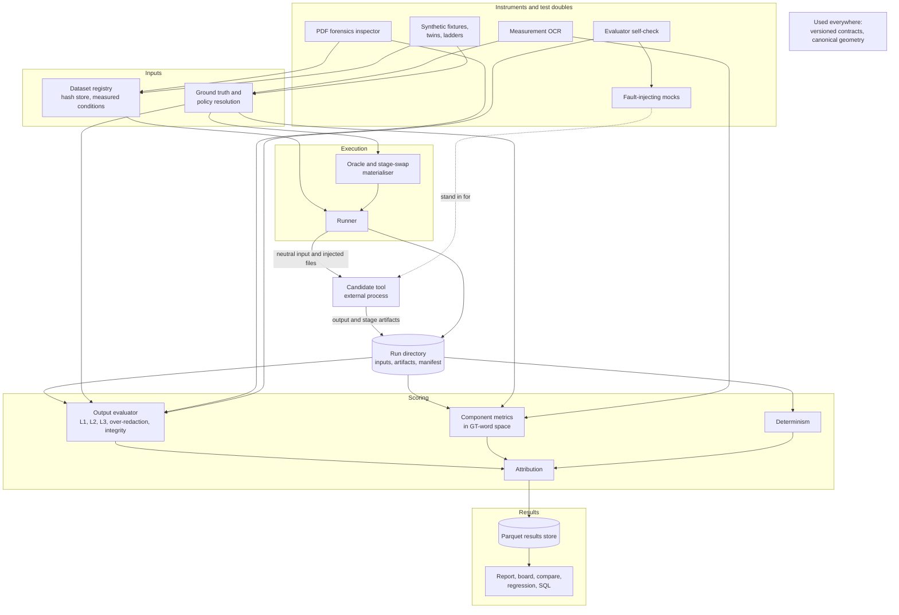

### Primary end-to-end workflow

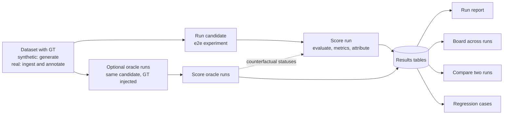

### Key components and responsibilities

- **Contracts:** versioned, strict schemas for GT, policy, dataset, candidate manifest,
  stage files, experiment and run. Unknown keys are errors. The schemas are exported as
  JSON Schema, and a test fails if the exported copies are out of date.
- **Geometry:** the only code that converts between coordinate frames. It covers the
  displayed page, unrotated space, raw PDF space and image pixels, including `/Rotate` and
  CropBox offsets. It also handles polygons and exact rasterisation.
- **Dataset registry:** stores PDFs under their hash and writes immutable manifests with
  automatically measured page conditions (encoding, DPI, skew, text direction). Original
  filenames are kept out of git.
- **Ground truth and policy:** reads and writes GT, validates it, measures agreement
  between annotators, produces machine drafts and review sheets, and applies the policy to
  give each word and mention a requirement.
- **Forensics inspector:** lists every place a PDF can hold content: text (including
  invisible text), image layers and masks, vector paths, annotations, metadata, the
  structure tree, revisions and unreferenced objects.
- **Runner and materialiser:** run a candidate over a dataset under an experiment. They
  build the injected inputs (from GT or from another run) and record everything in the run
  manifest.
- **Output evaluator:** decides, independently of any candidate, whether each mention is
  safe or leaking (L1/L2/L3), and measures over-redaction, integrity and document-level
  findings.
- **Component metrics:** score each exposed stage in GT-word space, including diagnosis of
  coordinate bugs and pseudonym checks.
- **Determinism:** compares repeats at levels D0–D3.
- **Attribution:** finds each failure's root cause, labels it confirmed or inferred,
  attributes over-redaction, and builds the failure funnel.
- **Results store and views:** Parquet tables queried with DuckDB, plus the run report,
  board, compare and regression suite.
- **Mocks:** stand-in redaction tools that read the GT and fail only in the ways they are
  told to. They expose every stage, follow the policy they are given and run either in-process
  or as external commands. One of them, the ceiling, does everything the client's rules ask.
- **Synthetic data and controlled inputs:** fictional documents in nine encodings, clean
  twins, and degradation ladders.
- **Self-check:** checks the evaluator's verdicts on any document that has GT.
- **Measurement OCR:** a pinned, local OCR instrument. If the selected engine is not
  installed, the work that depends on it is reported as not evaluable; the benchmark never
  silently switches to another engine.

### Important data/state relationships

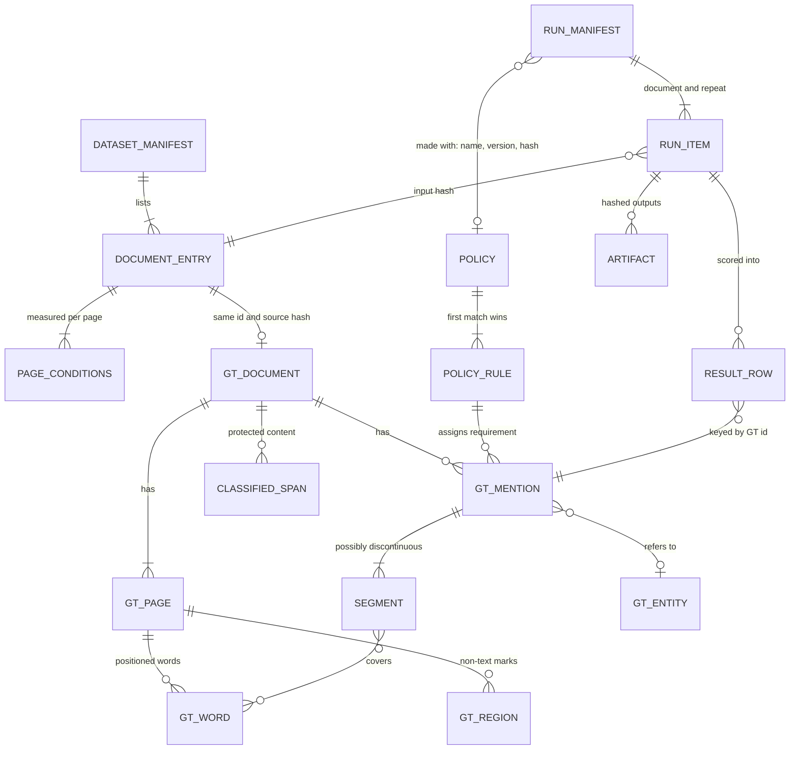

- **GT ids are the shared key.** GT word and mention ids join everything: verdicts, word
  outcomes, the mapping of tool claims onto GT words, comparisons and regression
  fingerprints.
- **The source hash links a document across the system:** the PDF store, the dataset
  manifest, the GT file and the input of every run item.
- **Mentions can be split.** A mention is a set of segments, each a set of words or regions
  on one page, optionally cut to a character range. This represents names split across
  lines, cells or form fields, and names nested inside emails or reference codes.
- **Policy precedence per word:** MUST > MAY > MUST_NOT > ORDINARY. A word inside any
  required mention must go, even if it is also protected.
- **Results are derived data.** They can always be rebuilt from the run directory plus GT,
  policy and evaluation settings.
- **Order matters for oracle evidence.** Oracle runs must be scored before the e2e run that
  cites them. Compare, regression and oracle evidence use repeat 0 only.

### Existing patterns worth preserving

- **Files, not a plugin API.** The benchmark never imports tool code, and the evaluator
  contains no tool-specific branches.
- **One frame, converted only at the edges.** Coordinates are converted to the standard
  frame where data enters or leaves the system. A tool's declared frame is checked against
  its files, never guessed.
- **GT-word space as the common currency** for scoring every stage.
- **GT records facts; the policy decides requirements.** Undecided questions map to MAY.
- **N/A rather than zero.** Undeclared files are ignored (`run_info.json` excepted).
- **Say what the scores follow.** The scoring policy, its departures from the client's answers
  and any mismatch with the run's policy are shown wherever scores are.
- **Confirmed and inferred causes are never combined.**
- **Thresholds in one hashed configuration.** Changing a threshold means a new evaluation
  version.
- **Strict schemas.** Bad input is rejected with a reason and never repaired.
- **Mutation testing with mocks.** Every new check gets a mock fault that it must catch,
  while the reference mock must stay clean.
- **Exact dependency pins,** because renderer and imaging versions change pixels.
- **Sensitive by default:** hash-addressed storage, neutral input filenames, git-ignored
  data, and a shareable report mode.
- **Instruments never switch silently.** A missing OCR engine means "not evaluable".
- **Tidy long tables.** New questions are answered with new queries, not new code.

### Relevant tests and coverage gaps

385 tests (they take roughly 15 to 20 minutes on the development laptop). They cover:

- **Geometry:** property-based round trips across every pair of frames, all rotations and
  CropBox offsets, checked against renders from both engines.
- **Evaluator acceptance**, on every synthetic encoding:
  - the reference mock comes out clean and the null mock leaks everything;
  - each of these faults is detected: overlay, annotation, translucent box, blur,
    incremental save, a kept text layer, a metadata leak, partial boxes, half-line shifts,
    DPI-scale confusion, over-redaction, false positives on protected content, a corrupt
    output and rotation flattened into the content;
  - the evaluator itself is deterministic.
- **Metrics:**
  - hand-computed coreference examples (MUC, B³, CEAF-e, LEA);
  - detection boundary classes;
  - coordinate-transform diagnosis;
  - plan versus output;
  - pseudonym and contact-format checks;
  - determinism.
- **Attribution:**
  - each injected fault maps to its expected category;
  - black-box causes are only ever inferred;
  - missing stages are N/A.
- **End to end:** mocks run as external processes through run, score, report, compare,
  regression and board. These tests also check neutral inputs, ignored undeclared files,
  oracle and stage-swap runs, failed runs in the strict view, ladder curves, the command
  placeholders and their quoting, a timed-out tool stopped with its child processes, the run's
  policy record and the warning when scores use another policy than the tool was given (none for
  a tool that never reads it), stage files and release verdicts written after the run left
  ungraded, and boards that mix policies.
- **The client's rules:** NOT_REPLACED, stand-ins for signatures (and drawn signatures left
  under a box; a new stand-in drawn to the original's size, or a label the signature crosses,
  is not taken for its strokes), the searchable and collateral pass marks, the policy's
  departures, release verdicts, matter consistency, every self-check under the client's policy
  on a fixture, and the ceiling mock clean on all nine encodings with one fake per person across
  a matter (also through the mock adapter, and with any spelling of gender in GT).
- **Controlled inputs:** twins and ladders keep the GT aligned, and verdicts survive
  degradation.
- **GT tools:** validators, agreement, drafts, review sheets, and that the exported schemas
  are up to date.
- **OCR:** the parsing and glued-word splitting run on recorded engine output. No real
  engine is launched in tests.

Gaps:

- **Seed GT is AI-annotated and unreviewed.** All acceptance testing uses fictional
  synthetic documents, plus the self-check on the five seed documents. Their GT is
  `gt_version 0.2-ai` (2,086 mentions: the AI annotator's 0.1-ai, archived under
  `data/gt-archive/`, with its addresses split by rule) and no human has reviewed it or the
  splits. The self-check ran on all five under the draft policy and eval-0.2: three checks
  fail, all evaluator calibration issues (see docs/metrics.md). It has not been run under the
  client's policy. Agreement between annotators has not been measured.
- **Real tools.** Tool 2 (`mlredact-client.yaml`) has been run end to end on the synthetic
  dataset (2026-10-22; results kept outside the repository). No real tool has been run on the
  seed documents, and tool 1 and the client's tool have no manifest yet.
- **`oracle_entities`** is not tested: no test runs the mode or the board's split of
  resolution from localization; only its input builder is used by one test.
- **Fakes at the original's size.** Correct fakes written in the original's font, size and
  place can be judged `PARTIAL` (an open calibration issue, kept visible by an expected-failure
  test); the ceiling mock avoids it by drawing its fakes smaller.
- **The CLI layer** is not tested directly; the tests call the functions behind it.
- **Shareable reports:** the test checks only the file name. It does not check that PII is
  actually masked.
- **OCR:** the real measurement OCR is never run in tests, and its calibration does not
  exist.
- **No CI,** so nothing runs automatically on change.

### Constraints and risks

- **Cost.**
  - Each page is rendered at 150 DPI or more by two engines, and again without annotations
    when the output has any.
  - For runs with repeats, each output is evaluated twice: once for the determinism check
    and once for scoring.
  - The measurement OCR takes about 30 seconds per page.
- **Validity range.** The evaluator is only valid between 150 and 300 DPI. Its thresholds
  were calibrated on synthetic documents and may need adjusting for real scans; the
  self-check is the safeguard.
- **Keeping GT from tools relies on convention.** GT is never placed in the working
  directory, but the tool runs as a local process with ordinary file access. The runs
  directory sits inside the repository by default, and mocks read GT through an environment
  variable by design. Nothing stops a tool that misbehaves from reading GT.
- **GT selection.** The first GT file on the search path whose document id and source hash
  match is used. If two files match (for example, two annotators' copies), one is chosen
  without warning; its version and hash are recorded with the scores.
- **Small seed set.** There are five documents, one per encoding, so the effects of
  document conditions cannot be separated from the effects of the individual documents.
  Confidence intervals are wide, and the seed documents cannot serve as a blind test set.
- **Policy departures.** Policy 1.1.0 replaces whole addresses: the project owner's rule for
  every tool since 2026-10-22, which a check of the GT address splits does not end. Only the
  owner can lift it; localities would then become kept items and scores would change. A tool
  that never reads the policy (no `{policy}`, no oracle inputs) can be rescored under a new
  policy rather than rerun; a tool or mock that follows `{policy}` should be run again, and
  scoring warns when it is not.
- **Windows command line.** Commands run through `cmd.exe`, so a value containing a double quote,
  `%`, `!` or a line break cannot be passed unchanged and is refused (a matter id never contains
  one, by schema). A timed-out command is stopped with `taskkill /T`, which reaches every process
  still attached to the command's process tree.
- **Sensitive outputs.** Results contain matched PII terms, and report galleries contain
  crops of real documents. Shareable mode masks only spans annotated in GT, so PII the
  annotators missed would still show.
- **Version drift.** Upgrading the renderer or imaging libraries changes pixels and
  therefore needs a new evaluation version. PyMuPDF is AGPL-licensed, which needs a review
  if the benchmark is ever distributed.

### Facts vs assumptions

**Facts.** Checked in the code on 2026-10-22:

- The candidate manifests in the repo are the mocks, the ceiling mock and tool 2's
  `mlredact-client.yaml`; tool 2 has been run on the synthetic dataset only, and no real tool on
  the seed documents.
- The default policy is `au-medicolegal-v1.yaml` 1.1.0 with two departures; every mock manifest
  passes `{policy}`.
- Leak verdicts use no OCR.
- The GT version and hash are recorded in scoring records; the run's policy, and whether it
  reached the tool, are recorded in the run manifest.
- `oracle_entities` has an experiment spec; no test runs the mode or the board's split of
  resolution from localization.
- There is no CI configuration.
- Each output in a run with repeats is evaluated twice.
- The shareable-report test checks only the file name.
- Nothing beyond the clean working directory isolates GT from a candidate.
- `data/gt/` holds `0.2-ai` GT for all five seed documents (2,086 mentions; annotator
  `claude-opus-5-5`, then the rule-based address split), `data/gt-archive/0.1-ai/` the earlier
  version, and `data/review/<DOC>/selfcheck-<DOC>.json` the self-check results under the draft
  policy. All are git-ignored.

**Taken from the docs and review files, not re-measured:**

- the test runtime and the OCR speed (README);
- the calibration figures (docs/metrics.md);
- the self-check results on the seed documents (read from the saved
  `data/review/<DOC>/selfcheck-<DOC>.json` files, not re-run).

**Assumptions:**

- PLAN.md is the roadmap and the code is the current truth.
- Items under "Built vs planned" are not built yet rather than dropped; the code does not
  say which.
- Report readers may include people outside engineering, which is why PII exposure through
  reports is listed as a risk.
